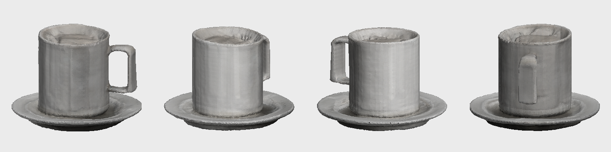
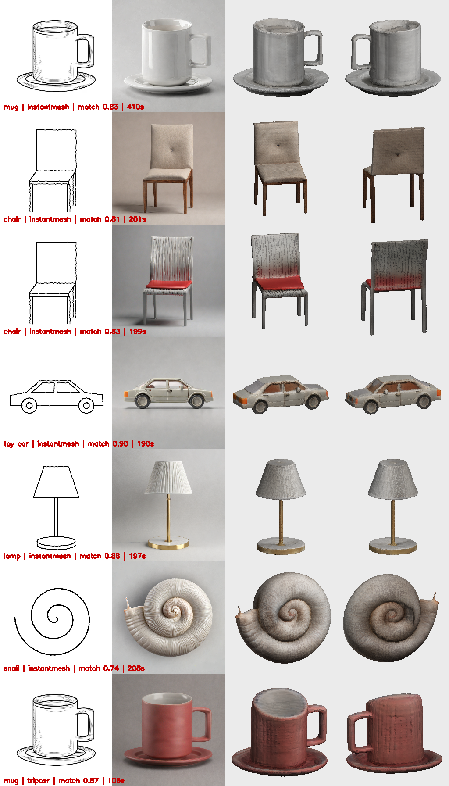

# Sketch2Shape AI — single-view sketch → textured, exportable 3D asset

TechZephyr 4.0 (IIT Bhubaneswar) · 24-hour hackathon · Computer Vision & Generative AI

Draw an object (or upload a photo/scan of a drawing), optionally describe it, and get a **real 3D mesh** you can rotate
in the browser and download as **`.glb`** (textured) and **`.obj`** (zipped with material + texture).



### Sample results (all from the live pipeline; files in `examples/outputs/`)
Columns: input sketch · selected 2D candidate · two views of the exported GLB (pure-NumPy preview renderer).



The car/chair/lamp/spiral inputs are simple synthetic line drawings (`scripts/make_demo_assets.py`); the mug is hand-drawn.
The chair + *"a fire-breathing dragon with red scales"* run (row 3) yields a **chair**: the allowlist-only hedge
candidate (keeps only "red") beat the dragon-prompted candidates in the ranker and the UI showed *"Your prompt seemed
to pull the result away from your sketch; the sketch was prioritised."* (same outcome on the RTX 4050).
Laptop (`lite`) results for the same sketches are in `examples/outputs/*_rtx4050/`.

*Above: four views of `examples/outputs/mug_balanced/mesh/model.glb`, produced from the hand-drawn
`tests/golden/mug_sketch.jpeg` with no text prompt (Kaggle T4, `balanced`).*

---

## 1. How it works

```
 Gradio 5 UI (draw / upload)  ◄── gradio_client / CLI (same core)
        ▼
 S1 Input ► S2 Understand ► S3 Generate-N & Rank ► S4 Prepare RGBA ► S5 Reconstruct (subprocess) ► S6 Cleanup ► S7 Export ► S8 Verify
                                                                                                         ▲                 │
                                                                                                         └──── 1 retry ◄───┘
```

| Stage | What it does | Key tech |
|---|---|---|
| **S1 Input** | canvas (brush/eraser/undo/clear) or upload; flatten alpha; cap long edge at 2048 | Gradio `ImageEditor` |
| **S2 Understand** | source-aware binarisation (illumination-normalised Otsu for photos of paper), stroke normalisation (uniform scale, consistent width), progressive dilate-fill-erode **silhouette** (or "open sketch"), **zero-shot object detection**, prompt composition | OpenCV, scikit-image, SigLIP |
| **S3 Generate & rank** | N sketch-conditioned product renders (ControlNet scale swept 0.5/0.7/0.9), one **hedge candidate** that keeps only colour/material/style words from your prompt; BiRefNet matting; **composite ranker** = silhouette IoU + stroke F-score (texture can't buy recall, extra parts cost precision) + SigLIP semantics + matte cleanliness | SDXL + `xinsir/controlnet-scribble-sdxl-1.0` + Hyper-SDXL 8-step **CFG** LoRA (fp16, 1024 px) · lite: SD1.5 + scribble ControlNet |
| **S4 Prepare** | clean, centred RGBA (object fills 85 %), edge colour decontamination | pymatting / OpenCV |
| **S5 Reconstruct** | image→3D in an **isolated subprocess with its own Python env**; OOM / crash can't take the UI down; automatic fallback chain | **InstantMesh** (Zero123++ multi-view → FlexiCubes LRM, texture map) · **TripoSR** (fast) |
| **S6 Cleanup** | seam-safe floater removal, repair, decimation, canonical pose (+Y up, front +Z, base at origin, unit height) | trimesh |
| **S7 Export** | Tier 1: textured GLB (UV + base-colour texture) · Tier 2: vertex-colour GLB; material PBR scalars patched into the GLB; zipped OBJ+MTL+PNG | trimesh, GLB JSON patcher |
| **S8 Verify** | reload GLB in a fresh process (non-empty, no NaNs, not flat, texture present); **closed-loop fidelity**: orthographic silhouette render (pure NumPy/OpenCV, no OpenGL) vs. the chosen 2D image and vs. your sketch; **mirror check**; ≤ 1 automatic retry | NumPy, OpenCV |

Every run writes `run.json` with per-stage time/VRAM/RAM, models + revisions, seeds, candidate scores, fallbacks,
fidelity scores and file sizes.

### Why the sketch stays in charge
* The ControlNet sees **only your strokes** (white-on-black, the model's trained format — verified on its model card).
* The **hedge candidate** + ranker: if your free-text prompt drags the image away from the drawing, the
  allowlist-only candidate wins and the UI says *"the sketch was prioritised"* (`prompt_conflict_suspected` in `run.json`).
* The final mesh is re-rendered and scored against your silhouette (**"Sketch match NN %"** badge).

---

## 2. Hardware assumptions & measured performance

All numbers below are **measured**, from `docs/phase0/*.json` and `run.json` files — nothing is estimated.

**Reference environment:** Kaggle notebook, Tesla T4 (15 GB, compute capability 7.5 → fp16), 31 GB RAM, CUDA driver 580, nvcc 12.8.

### End-to-end runs (generated by `scripts/timing_table.py`)

| GPU | profile | preset | 3D backend | 2D gen | S2 s | S3 (2D) s | S5 (3D) s | S4+S6–S8 s | total s | 2D peak VRAM GB | 3D peak VRAM GB | sketch match | run |
|---|---|---|---|---|---|---|---|---|---|---|---|---|---|
| Tesla T4 | balanced | balanced | instantmesh | balanced | 3.6 | 66.9 | 114.0 | 3.4 | 189.8 | 10.1 | 9.4 | 0.90 | car_side_balanced |
| NVIDIA GeForce RTX 4050 Laptop GPU | lite | balanced | triposr | lite | 1.4 | 17.2 | 16.2 | 2.3 | 38.7 | 2.9 | 2.4 | 0.86 | car_side_lite_rtx4050 |
| Tesla T4 | balanced | balanced | instantmesh | balanced | 3.9 | 70.0 | 121.2 | 3.7 | 200.6 | 10.1 | 9.4 | 0.81 | chair_balanced |
| Tesla T4 | balanced | balanced | instantmesh | balanced | 3.6 | 69.8 | 119.6 | 3.8 | 198.7 | 10.1 | 9.5 | 0.83 | chair_dragon_prompt_balanced |
| NVIDIA GeForce RTX 4050 Laptop GPU | lite | balanced | triposr | lite | 1.5 | 17.7 | 16.4 | 1.9 | 38.9 | 2.9 | 2.4 | 0.79 | chair_dragon_prompt_lite_rtx4050 |
| NVIDIA GeForce RTX 4050 Laptop GPU | lite | balanced | triposr | lite | 1.7 | 18.8 | 17.6 | 2.0 | 41.5 | 2.9 | 2.4 | 0.77 | chair_lite_rtx4050 |
| Tesla T4 | balanced | balanced | instantmesh | balanced | 3.7 | 66.7 | 120.4 | 3.9 | 196.6 | 10.1 | 9.4 | 0.88 | lamp_balanced |
| NVIDIA GeForce RTX 4050 Laptop GPU | lite | balanced | triposr | lite | 1.4 | 17.6 | 15.8 | 1.7 | 38.0 | 2.9 | 2.4 | 0.90 | lamp_lite_rtx4050 |
| Tesla T4 | balanced | balanced | instantmesh | balanced | 11.4 | 124.9 | 262.2 | 9.8 | 409.9 | 10.1 | 9.4 | 0.83 | mug_balanced |
| NVIDIA GeForce RTX 4050 Laptop GPU | lite | balanced | triposr | lite | 3.0 | 19.5 | 25.7 | 3.0 | 52.8 | 2.9 | 2.4 | 0.87 | mug_lite_rtx4050 |
| Tesla T4 | balanced | fast | triposr | balanced | 3.6 | 68.2 | 28.1 | 4.1 | 105.8 | 10.1 | 3.4 | 0.87 | mug_red_fast |
| NVIDIA GeForce RTX 4050 Laptop GPU | lite | balanced | triposr | lite | 1.4 | 17.5 | 16.6 | 2.3 | 39.2 | 2.9 | 2.4 | 0.90 | mug_red_lite_rtx4050 |
| Tesla T4 | balanced | balanced | instantmesh | balanced | 3.7 | 66.2 | 132.6 | 3.9 | 208.2 | 10.1 | 9.4 | 0.74 | open_doodle_balanced |
| NVIDIA GeForce RTX 4050 Laptop GPU | lite | balanced | triposr | lite | 1.5 | 19.6 | 16.8 | 2.5 | 41.9 | 2.9 | 2.4 | 0.68 | open_doodle_lite_rtx4050 |

_Generated by `scripts/timing_table.py` from 14 run.json file(s). 3D VRAM is measured inside the backend subprocess (nvidia-smi polling); 2D VRAM is torch.cuda.max_memory_allocated in the parent._

**Typical times (measured above):**
* **Kaggle T4, `balanced`** (4 SDXL candidates → InstantMesh-large textured): **≈ 190–210 s** per sketch once the
  server is warm (SDXL restored from system RAM in 3 s instead of 48–55 s from disk); **≈ 410 s for the very first
  request** of a fresh session (cold model loads).
* **Kaggle T4, `fast`** (TripoSR): **≈ 106 s** warm.
* **RTX 4050 laptop (6 GB), `lite`** (2 SD1.5 candidates → TripoSR-fast): **≈ 38–53 s**.
* Peak VRAM: SDXL stage 10.1 GB, InstantMesh 9.4 GB, TripoSR 2.4–3.4 GB (stages never overlap on the GPU).

### Backend measurements (Phase 0, repo's bundled example image)

| Backend / setting | Wall time | Peak VRAM | Output |
|---|---|---|---|
| TripoSR, mc 256 / chunk 8192 | 16 s warm (35 s cold incl. download) | 5.55 GB | vertex colours |
| TripoSR, mc 192 / chunk 2048 | 17 s | 3.41 GB | vertex colours |
| InstantMesh base, grid 128 | 85 s | 11.3 GB | vertex colours |
| InstantMesh large, grid 128 | — | **OOM** (needs a 15 GiB allocation) | — |
| InstantMesh large, grid 112 | 74 s | 13.96 GB | vertex colours |
| InstantMesh large, grid 96 | — | 9.4 GB | vertex colours |
| InstantMesh large, grid 96 + texture map | 80 s | 9.44 GB | **UV texture** |

### Profiles (auto-selected by VRAM)
| Profile | Needs | 2D stage | 3D chain |
|---|---|---|---|
| `balanced` | ≥ 14 GB (Kaggle/Colab T4, A10G, …) | SDXL + ControlNet + Hyper-SD, 1024 px, 4 candidates | InstantMesh → TripoSR |
| `lite` | 5–13 GB | SD1.5 + ControlNet, CPU offload, 512 px, 2 candidates | TripoSR (needs ≥ 3.4 GB free) |
| no CUDA | — | clear message; `sketch2shape doctor` explains | — |

Disk: parent env 6.0 GB, TripoSR env 4.8 GB, InstantMesh env 5.2 GB, weights ≈ 25.6 GB (`balanced`, measured with `du`).
First-time setup on Kaggle: ≈ 7 min for the three environments (built in parallel) + weight download.

---

## 3. Quick start

### A. Kaggle (recommended — no local GPU needed; this is how all T4 numbers were produced)
Open **`kaggle/Sketch2Shape_Kaggle_demo.ipynb`** in Kaggle (Accelerator **GPU T4**, Internet **on**) and *Run all*:
it builds the three environments in parallel (~7 min), downloads the pinned weights (~25 GB, no token) and starts
the UI with a public `*.gradio.live` link. Scripted use against that link:
`sketch2shape run --remote https://xxxx.gradio.live --sketch my_sketch.png`.

### B. Linux / WSL2 with an NVIDIA GPU
```bash
make setup                         # parent env + one isolated env per 3D backend (uv provisions Python 3.10)
make weights PROFILE=balanced      # or PROFILE=lite on 6–12 GB cards; no HF token needed
make doctor                        # go / no-go table + recommended profile
make demo                          # http://localhost:7860
```

### CLI
```bash
sketch2shape run --sketch my_chair.png --prompt "walnut wood, green velvet seat" --preset balanced --out outputs/
sketch2shape run --sketch my_chair.png --remote https://xxxx.gradio.live      # use a remote GPU
sketch2shape doctor
```

### Inputs / outputs
* **Input:** PNG/JPG/WEBP/BMP sketch (canvas drawing, scan or phone photo of paper); optional text; optional
  object override, material, quality (Fast/Balanced/Best), seed, viewpoint.
* **Output folder** `outputs/<timestamp>_<hash>/`: `mesh/model.glb`, `mesh/model.obj.zip`, `preview_front.png`,
  `selected_rgba.png`, `candidates/*.png`, `input/{sketch_input,sketch_clean,silhouette}.png`, `run.json`.

---

## 4. Model choices and rejected alternatives

| Choice | Why |
|---|---|
| SDXL + xinsir scribble ControlNet | best sketch adherence of the open scribble ControlNets; Apache-2.0 |
| Hyper-SDXL **8-step CFG** LoRA | 8 steps on a T4 while keeping classifier-free guidance, so the negative prompt (no shadows / ground planes, which would get baked into the mesh) still works. Plain Hyper-SD LoRAs need guidance 0. |
| InstantMesh (large @ FlexiCubes grid 96) | named in the brief; multi-view diffusion gives plausible backs; texture-map export; grid 96 measured at 9.4 GB vs OOM at 128 |
| TripoSR | MIT, 16 s, 3.4–5.6 GB: the fast preset and the fallback on smaller GPUs |
| SigLIP zero-shot | free, ungated, no remote code; the "Detected object" box stays editable |
| BiRefNet (+ rembg fallback) | high-quality mattes; MIT |

**Evaluated but not shipped**

| Item | Reason |
|---|---|
| TRELLIS.2-4B | model card requires ≥ 24 GB VRAM (A100/H100); a T4 has 15 GB |
| InstantMesh large at default grid 128 | measured OOM on T4 (15 GiB allocation) |
| TripoSR `--bake-texture` | measured failure headless (`moderngl` needs an X display) |
| Qwen2.5-VL (4-bit) captioning | bitsandbytes / flash-attn fragility on T4; replaced by SigLIP zero-shot |
| Stable Fast 3D (SF3D) | gated weights; not needed for the default no-token install |
| Hunyuan3D, Unique3D | not evaluated in the 24 h window |

Full attribution with revisions and licences: [LICENSES_AND_MODELS.md](LICENSES_AND_MODELS.md).

---

## 5. Engineering notes
* **Process isolation:** each 3D backend has its own `uv` env pinned from its own README (`envs/*.lock.txt`) and runs as
  `<env python> adapters/<name>_run.py --input … --out …`. The UI process never imports backend code; VRAM is fully
  released when the subprocess exits; timeouts/cancel kill the whole process tree.
* **Calibrated orientation:** each adapter maps its backend's frame to +Y up / front +Z. `scripts/calibrate_backend.py`
  reconstructs an asymmetric mug (handle on the right) and **refuses to enable a backend if the mirrored render fits
  better**. InstantMesh: direct 0.905 vs mirrored 0.564; TripoSR: direct 0.941 vs mirrored 0.565 (`docs/calibration/`).
* **Graceful degradation:** OOM ladder in 2D (fewer candidates → SD1.5), backend fallback chain in 3D, every optional
  model behind a capability probe; the UI never shows a stack trace (details go to `run.json`).
* **Tests:** `make test` — 41 tests incl. renderer regression, ranker, seam-safe pruning, GLB patching, subprocess
  resolution, OOM fallbacks and a CPU end-to-end smoke test.

## 6. Limitations
* Hidden sides are inferred, not recovered; thin parts and text/logos may be lost.
* Generation needs an NVIDIA GPU: ≈ 3.3 min per model on a T4 in `balanced` (≈ 7 min for the first request of a session), ≈ 40 s on an RTX 4050 in `lite`.
* Object detection uses a closed vocabulary (~190 nouns); override with the "Detected object" box.
* InstantMesh needs Linux/WSL2 (nvdiffrast); nvdiffrast's licence is non-commercial.
* 6 GB laptop GPUs with a desktop session using 3–4 GB cannot run even TripoSR locally — use the remote mode.

See [TROUBLESHOOTING.md](TROUBLESHOOTING.md).
